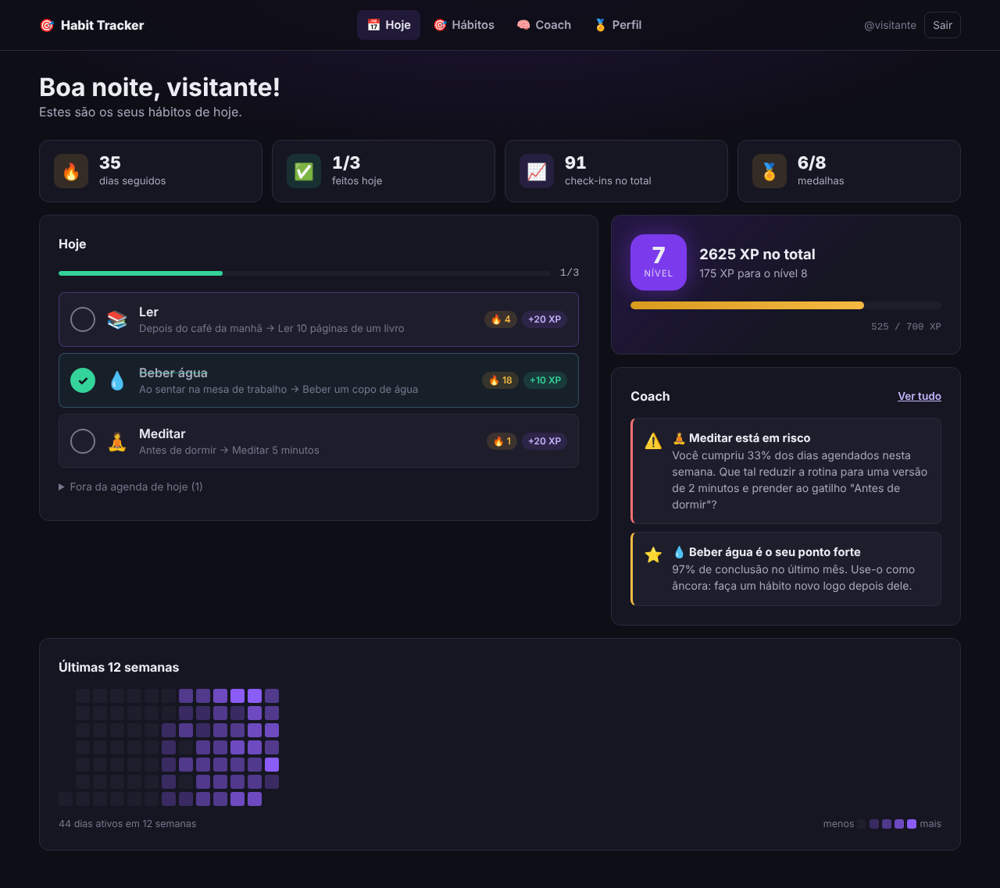
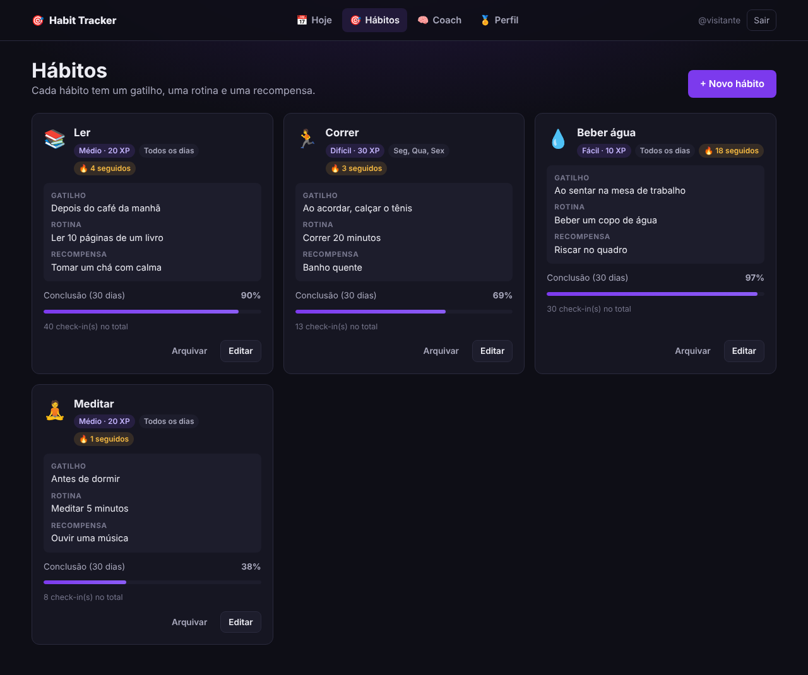
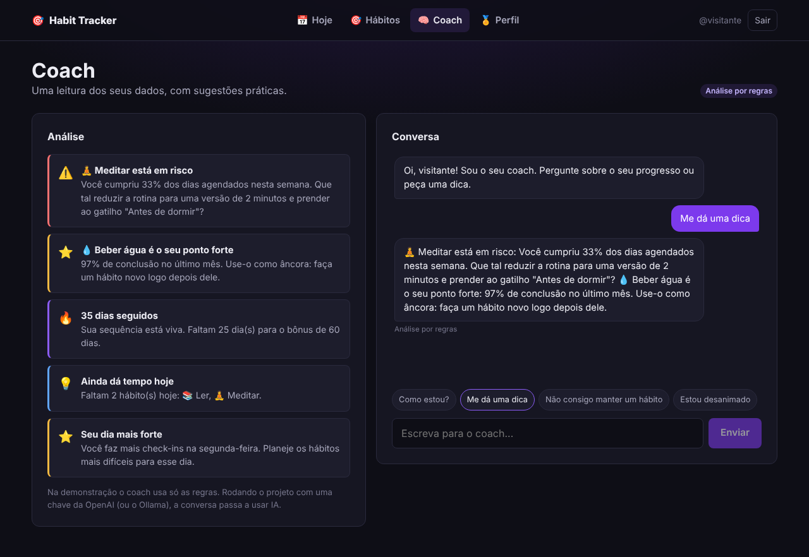
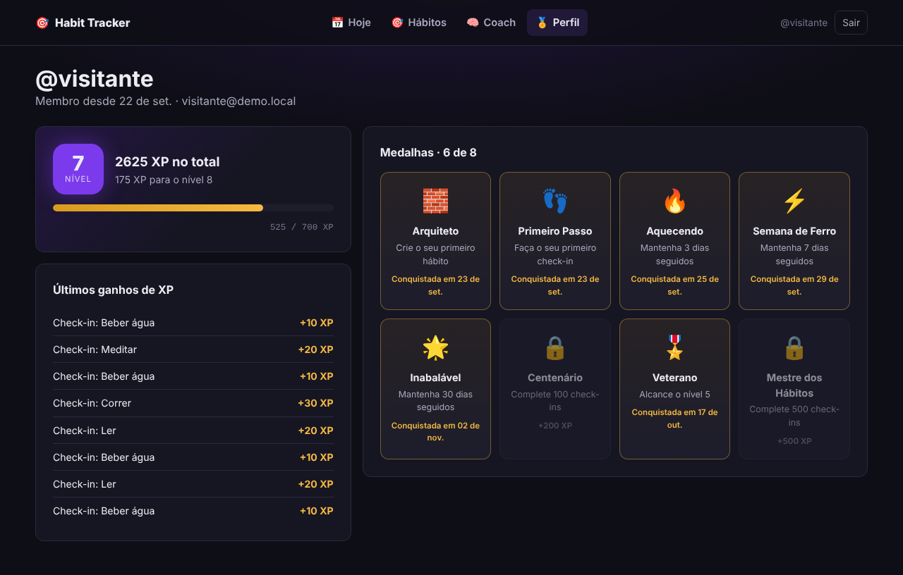
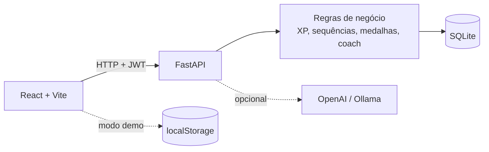

# Habit Tracker

Aplicação full-stack para criar hábitos no ciclo **gatilho → rotina → recompensa**, ganhar XP e medalhas a cada check-in e receber dicas de um coach que analisa os seus dados.

**[Abrir a demonstração](https://braga93.github.io/habit-tracker/)**: roda direto no navegador, com uma conta de visitante e dados de exemplo.

[](https://github.com/Braga93/habit-tracker/actions/workflows/ci.yml)




## Funcionalidades

- **Hábitos no ciclo do hábito:** cada um tem gatilho, rotina e recompensa, ícone, dificuldade e os dias da semana em que vale.
- **Check-in diário:** um por hábito por dia, que pode ser desfeito no mesmo dia (o XP volta).
- **XP e níveis:** a dificuldade define o XP (10, 20 ou 30), e há bônus ao completar 7, 14, 30, 60 e 100 dias seguidos.
- **Sequências justas:** contam só os dias agendados e não zeram enquanto o dia de hoje ainda está em aberto.
- **8 medalhas:** de criar o primeiro hábito a completar 500 check-ins.
- **Mapa de atividade:** as últimas 12 semanas em um calendário de calor.
- **Coach:** aponta hábitos em risco, o hábito mais forte e o dia da semana mais produtivo. Com uma chave da OpenAI (ou um modelo local pelo Ollama), também conversa usando IA; sem chave, responde pelas regras.
- **Contas protegidas:** senha com bcrypt e sessão com token JWT.
- **Responsivo:** do celular ao monitor ultrawide, com barra de navegação inferior no celular.

| Hábitos | Coach | Perfil |
|---|---|---|
|  |  |  |

## Tecnologias

| Camada | Tecnologias |
|---|---|
| API | Python 3.12, FastAPI, SQLModel, SQLite, bcrypt, PyJWT, httpx |
| Interface | React 18, Vite, React Router, CSS Modules |
| Qualidade | pytest, Vitest, Ruff, GitHub Actions |
| Execução | Docker e Docker Compose, GitHub Pages (demonstração) |

## Arquitetura



- **Regras de negócio puras** (`backend/app/domain`): níveis, sequências, taxa de conclusão, medalhas e o coach são funções sem banco de dados, testadas isoladamente.
- **Serviços** (`backend/app/services`): aplicam as regras com o banco e a autenticação.
- **Interface em atomic design** (`frontend/src/components`): átomos, moléculas, organismos e templates.
- **Uma interface de API, duas implementações** (`frontend/src/api`): o cliente HTTP fala com o FastAPI; o cliente de demonstração aplica as mesmas regras no navegador. As telas não sabem de qual dos dois os dados vêm.

O planejamento completo, com o diagnóstico da versão anterior e as decisões tomadas, está em [`docs/PLANO.md`](docs/PLANO.md).

## Como rodar

### Pré-requisitos

- Python 3.11 ou superior
- Node.js 20 ou superior

### API

```bash
cd backend
python -m venv .venv
source .venv/bin/activate        # no Windows: .venv\Scripts\activate
pip install -r requirements-dev.txt
cp .env.example .env             # no Windows: copy .env.example .env
uvicorn app.main:app --reload
```

A API fica em `http://localhost:8000`, e a documentação interativa (Swagger) em `http://localhost:8000/docs`.

### Interface

Em outro terminal:

```bash
cd frontend
npm install
npm run dev
```

Abra `http://localhost:5173`. As chamadas para `/api` são encaminhadas para a API automaticamente.

### Com Docker

```bash
docker compose up --build
```

A interface fica em `http://localhost:8080` e a API em `http://localhost:8000`.

### Modo demonstração

```bash
cd frontend
npm run build:demo
```

Gera uma versão que não precisa da API: tudo roda no navegador, com a conta `visitante` / `demonstracao`. É a versão publicada no GitHub Pages.

## Variáveis de ambiente

Ficam no arquivo `backend/.env` (modelo em `backend/.env.example`).

| Variável | Descrição | Padrão |
|---|---|---|
| `DATABASE_URL` | Endereço do banco | `sqlite:///./habit_tracker.db` |
| `SECRET_KEY` | Chave que assina os tokens. **Troque em produção** | valor de desenvolvimento |
| `TOKEN_EXPIRE_MINUTES` | Validade do login | `10080` (7 dias) |
| `CORS_ORIGINS` | Endereços autorizados a chamar a API | `http://localhost:5173` |
| `OPENAI_API_KEY` | Chave para o coach conversar com IA (opcional) | vazia |
| `OPENAI_BASE_URL` | Endereço da API de IA (use o do Ollama para rodar local) | `https://api.openai.com/v1` |
| `LLM_MODEL` | Modelo usado pelo coach | `gpt-4o-mini` |

## API

| Método | Rota | Descrição |
|---|---|---|
| POST | `/api/auth/register` | cria a conta e devolve o token |
| POST | `/api/auth/login` | entra com usuário ou e-mail |
| GET | `/api/auth/me` | dados do usuário logado |
| GET | `/api/habits` | hábitos ativos com sequência e taxa de conclusão |
| POST | `/api/habits` | cria um hábito |
| PATCH | `/api/habits/{id}` | edita um hábito |
| DELETE | `/api/habits/{id}` | arquiva um hábito (o histórico fica) |
| POST | `/api/habits/{id}/checkins` | check-in de hoje, com XP, bônus e medalhas |
| DELETE | `/api/habits/{id}/checkins/today` | desfaz o check-in de hoje |
| GET | `/api/progress` | nível, sequência, mapa de atividade e medalhas |
| GET | `/api/coach/insights` | análise dos hábitos |
| POST | `/api/coach/chat` | conversa com o coach |

## Testes

```bash
cd backend && pytest
cd frontend && npm test
```

- **Backend:** 42 testes. Cobrem as regras de nível, sequência, conclusão e medalhas, o coach, e as rotas com um banco em memória: cadastro, senha criptografada, acesso sem token, check-in duplicado, desfazer, bônus de 7 dias e isolamento entre usuários.
- **Frontend:** 22 testes. Cobrem as mesmas regras na versão em JavaScript e a API de demonstração.

A cada push, o GitHub Actions roda o lint, os testes e o build.

## Estrutura

```text
habit-tracker/
├── backend/
│   ├── app/
│   │   ├── domain/        regras puras: níveis, sequências, medalhas, coach
│   │   ├── services/      regras com banco: hábitos, progresso, XP, coach
│   │   ├── routers/       rotas da API
│   │   ├── models.py      tabelas
│   │   ├── schemas.py     validação de entrada e saída
│   │   ├── security.py    bcrypt e JWT
│   │   └── main.py
│   └── tests/
├── frontend/
│   └── src/
│       ├── api/           cliente HTTP e cliente de demonstração
│       ├── domain/        as mesmas regras, para o modo demo
│       ├── components/    atoms, molecules, organisms, templates
│       ├── pages/
│       ├── context/       sessão e avisos
│       └── hooks/
├── docs/
├── docker-compose.yml
└── .github/workflows/     testes e publicação da demonstração
```

## Próximos passos

- Migrações de banco com Alembic
- Lembretes por e-mail ou notificação
- Exportar o histórico em CSV
- Testes de interface ponta a ponta com Playwright na integração contínua

## Autor

**Eduardo Braga**, desenvolvedor full-stack em Fortaleza, CE.
[LinkedIn](https://www.linkedin.com/in/eduardo-braga-6131b9253/) · [GitHub](https://github.com/Braga93)
