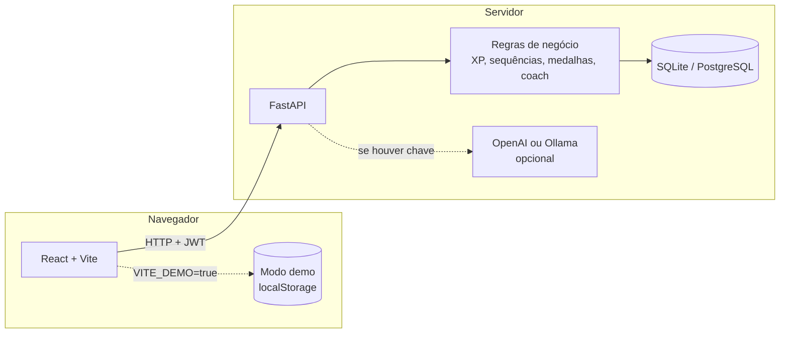

# Planejamento · Reformulação do Habit Tracker

## 1. Ponto de partida

O projeto original era um app em Python com o framework **Reflex**: hábitos no ciclo gatilho → rotina → recompensa, XP, níveis, medalhas e um coach de IA. A ideia é boa, mas a revisão encontrou problemas.

### Erros de funcionamento

| Problema | Efeito |
|---|---|
| A fórmula de nível começava em 100 XP | Barra de progresso **negativa** (-33%) para quem acabou de criar a conta |
| A sequência só contava a partir de hoje | Quem cumpriu ontem e ainda não marcou hoje via a sequência **zerada** |
| A taxa de conclusão dividia sempre por 30 | Um hábito criado ontem aparecia com 3% de conclusão |
| A medalha de "primeiro hábito" existia no modelo, mas nunca era avaliada | Medalha impossível de ganhar |
| Medalhas de nível eram avaliadas antes do XP de outras medalhas | Medalha liberada só no check-in seguinte |

### Segurança

- Senhas com **SHA-256 sem sal**: vulnerável a tabelas pré-calculadas.
- As páginas não verificavam login: `/dashboard` abria sem autenticação.
- O "login" vivia só no estado da tela, sem token nem sessão no servidor.

### Organização

- Redis declarado no Docker e nunca usado; frequência semanal, humor e notas declarados e nunca usados.
- Endereço do banco escrito em dois lugares diferentes.
- Nenhum teste.
- Interface em inglês.
- O coach só funcionava com uma chave paga da OpenAI.
- Para ver o projeto era preciso instalar Python, Node e o Reflex.

## 2. Decisões

| Tema | Decisão | Motivo |
|---|---|---|
| Backend | **Python + FastAPI** | API REST documentada automaticamente (Swagger), tipagem com Pydantic, mercado amplo |
| Frontend | **React + Vite**, em atomic design | Separação clara entre interface e API; mesmo padrão do portfólio |
| Banco | **SQLite** com **SQLModel** | Zero configuração para quem clona; troca para PostgreSQL só pela variável `DATABASE_URL` |
| Login | **bcrypt** + **JWT** | Senha com sal e custo ajustável; API sem estado |
| Coach | **Regras próprias** + IA opcional | Funciona para qualquer pessoa; com chave da OpenAI (ou Ollama local) as respostas vêm da IA |
| Demonstração | **Modo demo no GitHub Pages** | O front roda sozinho, com dados de exemplo no navegador. O olheiro só abre o link |
| Idioma | **Português** | Mesmo idioma do perfil |
| Qualidade | **pytest**, **Vitest** e **GitHub Actions** | Toda alteração passa pelos testes antes de publicar |

## 3. Arquitetura



O front conversa com a API por uma interface única (`api`). No modo demonstração, essa interface é trocada por uma implementação que guarda tudo no `localStorage` e aplica as mesmas regras, então as telas não sabem de qual das duas os dados vêm.

### Estrutura de pastas

```text
habit-tracker/
├── backend/
│   ├── app/
│   │   ├── main.py            criação da API, CORS e rotas
│   │   ├── config.py          variáveis de ambiente
│   │   ├── database.py        conexão e sessão do banco
│   │   ├── models.py          tabelas
│   │   ├── schemas.py         formatos de entrada e saída
│   │   ├── security.py        bcrypt e JWT
│   │   ├── deps.py            usuário logado
│   │   ├── domain/            regras puras, sem banco (fáceis de testar)
│   │   ├── services/          regras que usam o banco
│   │   └── routers/           rotas: auth, habits, progress, coach
│   └── tests/
├── frontend/
│   └── src/
│       ├── api/               cliente HTTP e cliente demo
│       ├── domain/            as mesmas regras, para o modo demo
│       ├── components/        atoms, molecules, organisms, templates
│       ├── pages/
│       ├── context/           sessão do usuário
│       └── hooks/
├── docker-compose.yml
└── .github/workflows/         testes e publicação da demo
```

## 4. Regras de negócio

### Hábitos
- Nome, gatilho, rotina, recompensa, ícone e dificuldade.
- **Frequência:** todos os dias ou dias da semana escolhidos.
- **Dificuldade** define o XP: fácil 10, médio 20, difícil 30.
- Arquivar em vez de apagar, para não perder o histórico.

### Check-in
- Um por hábito por dia, com humor opcional (1 a 5) e uma nota curta.
- Pode ser desfeito no mesmo dia; o XP daquele check-in é devolvido.

### Níveis
- XP total para alcançar o nível *n*: `50 × n × (n − 1)` → nível 2 em 100 XP, nível 3 em 300, nível 4 em 600, nível 5 em 1.000.
- O progresso começa em 0% em todo nível.

### Sequências
- **Geral:** dias seguidos com pelo menos um check-in. Se hoje ainda não houve check-in, a contagem parte de ontem.
- **Por hábito:** conta só os dias em que o hábito estava agendado.
- **Bônus** ao atingir 7, 14, 30, 60 e 100 dias seguidos: 50, 75, 150, 300 e 500 XP.

### Taxa de conclusão
- Check-ins ÷ dias agendados, nos últimos 30 dias **ou desde a criação do hábito**, o que for menor.

### Medalhas

| Medalha | Condição | Bônus |
|---|---|---|
| Arquiteto | criar o primeiro hábito | 25 XP |
| Primeiro Passo | primeiro check-in | 25 XP |
| Aquecendo | 3 dias seguidos | 50 XP |
| Semana de Ferro | 7 dias seguidos | 100 XP |
| Inabalável | 30 dias seguidos | 300 XP |
| Centenário | 100 check-ins | 200 XP |
| Veterano | nível 5 | 150 XP |
| Mestre dos Hábitos | 500 check-ins | 500 XP |

As medalhas são reavaliadas até não haver nenhuma nova, então o XP de uma medalha pode liberar a medalha de nível no mesmo check-in.

### Coach
- **Análise por regras:** hábitos em risco (menos de 50% nos últimos 7 dias agendados), melhor hábito, dia da semana mais forte, sequência atual e sugestões práticas.
- **Conversa:** com chave de IA, a resposta vem do modelo com os seus dados como contexto; sem chave, ou se a IA falhar, o coach responde pelas regras e informa a origem.

## 5. API

| Método | Rota | Descrição |
|---|---|---|
| POST | `/api/auth/register` | cria a conta e devolve o token |
| POST | `/api/auth/login` | entra e devolve o token |
| GET | `/api/auth/me` | dados do usuário logado |
| GET | `/api/habits` | hábitos ativos com estatísticas |
| POST | `/api/habits` | cria um hábito |
| PATCH | `/api/habits/{id}` | edita um hábito |
| DELETE | `/api/habits/{id}` | arquiva um hábito |
| POST | `/api/habits/{id}/checkins` | check-in de hoje |
| DELETE | `/api/habits/{id}/checkins/today` | desfaz o check-in de hoje |
| GET | `/api/progress` | nível, XP, sequência, mapa de atividade e medalhas |
| GET | `/api/coach/insights` | análise por regras |
| POST | `/api/coach/chat` | conversa com o coach |
| GET | `/api/health` | situação da API |

A documentação interativa fica em `/docs` (Swagger).

## 6. Etapas

1. Backend: modelos, regras de domínio, autenticação e rotas.
2. Testes do backend: regras puras e rotas com banco em memória.
3. Frontend: telas, sessão, cliente da API e modo demonstração.
4. Docker, integração contínua e publicação da demo no GitHub Pages.
5. README com prints, instruções e decisões técnicas.
6. Verificação ponta a ponta: API e front juntos, demo, celular e desktop.

## 7. Próximos passos (fora deste escopo)

- Migrações de banco com Alembic.
- Lembretes por e-mail ou notificação.
- Exportar o histórico em CSV.
- Testes de interface ponta a ponta (Playwright) na integração contínua.
